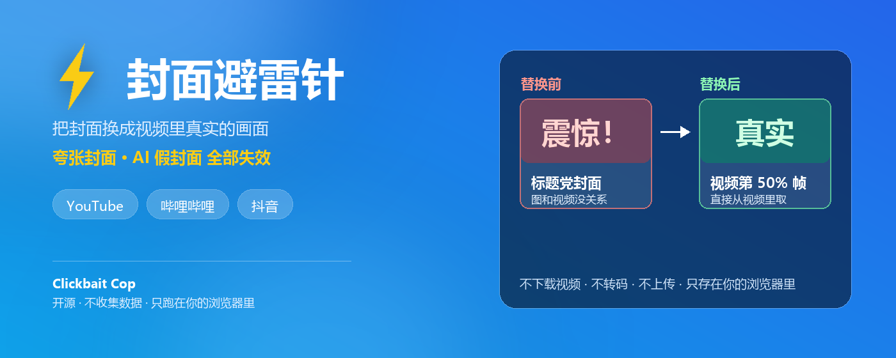
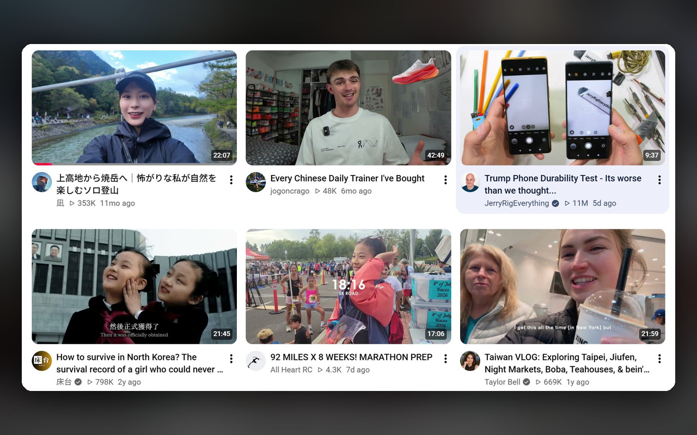
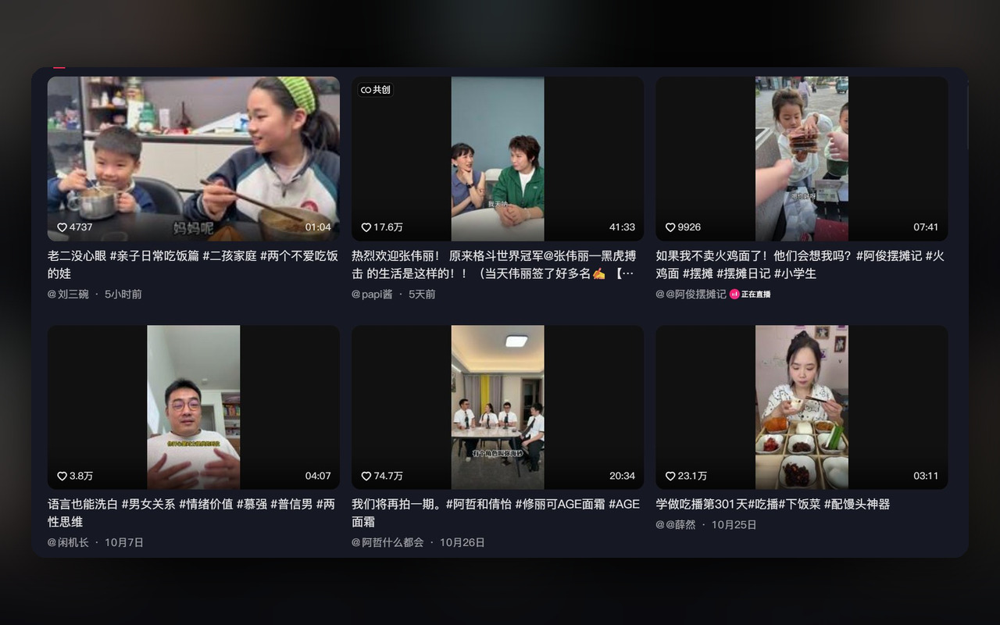

## 手动安装

Chrome 应用商店已上线，直接在商店搜索「**封面避雷针**」一键安装即可，**不需要**下面的步骤。

想手动装、或想提前用上 1.3.3 这版竖屏修复的，按这三步：

1. 下载下方 `cover-lightning-rod-1.3.3.zip` 并解压到任意目录
2. 打开 `chrome://extensions`，打开右上角「开发者模式」
3. 点「加载已解压的扩展程序」，选中解压出来的文件夹

装好后打开 YouTube、哔哩哔哩或抖音，封面会被换成视频里真实的画面。点工具栏图标可以切前段/中段/后段三档取帧，也可以按站点单独开关。

> 手动安装的是开发者模式扩展，Chrome 每次启动会提示「请停用开发者模式扩展程序」，点关闭即可。商店版没有这个提示，建议用商店版。

## 这个版本改了什么

**1.3.3 主要修抖音竖屏视频的模糊问题**

之前竖版封面被塞进横版卡片里，CSS 的 `object-fit: cover` 会把它横向放大将近 2 倍，加上平台预览图本身只有 200~300px 宽，替换后特别糊。

现在竖版画面遇到横版容器时改用 `object-fit: contain`：保持原比例居中显示，放大倍数降到 1 以下，两侧留深色边。横版封面和 B 站、YouTube 不受影响。

其它：

- 商店素材统一换成图标同款蓝底（小宣传图 440×280、横幅 1400×560），和 128 图标同一套配色
- 新增两张 1280×800 商店截图
- 权限没有变化，不会要求重新授权

## 功能一览

- 覆盖 YouTube、哔哩哔哩、抖音，含抖音精选页、搜索页、个人主页
- 封面替换为视频里的真实画面，夸张封面和 AI 生成的假封面一并失效（不做 AI 检测，是替换之后假封面自然失效）
- 前段 25% / 中段 50% / 后段 75% 三档取帧，默认中段
- 竖版视频保持原比例，不放大、不变形
- 不下载视频、不转码、不上传，复用平台自带的进度条预览图，本地裁剪
- 结果只存在你自己浏览器的缓存里，最多 1500 条，卸载插件即清除；不收集任何个人数据

## 已知限制

- 极短视频、图文、直播、广告等没有预览图的视频，保留原封面
- 横版大卡片仍会略糊：抖音精选顶部大图平台的单帧预览只有 240×136，本身放大约 4 倍
- 竖版封面改为原比例后，两侧会留深色边（这是为清晰度做的取舍）
- B 站多 P 视频只取第 1 集的画面
- YouTube Shorts 是竖版，为避免变形不做替换

开源协议 MIT，源码：https://github.com/hiyanyang/clickbait-cop
